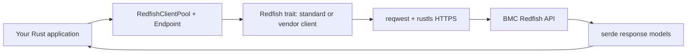

# libredfish

[](https://github.com/dsx-ai-factory/libredfish/actions/workflows/ci.yml)
[](rust-toolchain.toml)
[](LICENSE)

**libredfish is an asynchronous Rust client library for the [DMTF Redfish API](https://redfish.dmtf.org/).**
It lets infrastructure applications query and manage server hardware through a
baseboard management controller (BMC), with common operations and vendor-specific
implementations behind one `Redfish` trait.

Use it when you build Rust inventory, provisioning, or hardware management
software that must communicate with BMCs. It is a library to embed in an
application; it does not provide a standalone command-line tool or a server.

- [Capabilities and limits](#capabilities-and-limits)
- [Install from source](#install-from-source)
- [Read-only example](#read-only-example)
- [Architecture](#architecture)
- [Documentation and support](#documentation-and-support)
- [Contribute](#contribute)
- [License](#license)

## Capabilities and limits

- Read systems, chassis, managers, hardware and firmware inventory, sensors, and
  task state.
- Perform power, boot, BIOS, account, firmware, and security configuration
  operations where the target platform implements them.
- Use standard Redfish behavior with vendor implementations for Dell, HPE,
  Lenovo, Supermicro, AMI, NVIDIA platforms, Lite-On and Delta power shelves,
  and the Sushy emulator. See the [vendor model](src/model/service_root.rs) and
  [implementation modules](src/lib.rs) for the current set.
- Reuse an HTTPS connection pool with configurable timeouts, proxy settings,
  trusted certificate bundles, and client certificates.

Redfish resources and OEM behavior vary by BMC model and firmware. A vendor
implementation does not imply support for every operation or firmware version.
Methods can return `RedfishError::NotSupported`; verify the methods you need on
your hardware. The [mock integration tests](tests/integration_test.rs) cover
recorded responses, but do not prove that a real BMC applies write operations.

The integrating application must control access, supply credentials, and
authorize privileged operations. See [SECURITY.md](SECURITY.md) for trust
boundaries, logging risks, TLS configuration, and firmware input requirements.

## Install from source

Prerequisites:

- [Rust and Cargo](https://www.rust-lang.org/tools/install), using the pinned
  **Rust 1.90.0** toolchain in [rust-toolchain.toml](rust-toolchain.toml).
- Git and network access to fetch this repository and Cargo dependencies.
- For live requests: network access to the BMC HTTPS endpoint, an appropriate
  BMC account, and a trusted server certificate or CA bundle.
- For the integration tests: Python 3 with `venv` and `pip`; see
  [CONTRIBUTING.md](CONTRIBUTING.md).

The [Cargo manifest](Cargo.toml) restricts publication to the `internal` registry.
Do not assume that a package with the same name on crates.io is this project.
Use a source dependency pinned to a reviewed commit:

```toml
[dependencies]
libredfish = { git = "https://github.com/dsx-ai-factory/libredfish.git", rev = "e42f2c515e7fb1f71fbecf88b5889a155ee23e03" }
tokio = { version = "1", features = ["macros", "rt-multi-thread"] }
```

To build this checkout:

```sh
git clone https://github.com/dsx-ai-factory/libredfish.git
cd libredfish
cargo build
```

## Read-only example

The [service-root example](examples/service_root.rs) reads the Redfish version.
It uses the standard client and performs only GET requests, including possible
chassis reads when the service root omits vendor information. It makes no
configuration changes and keeps TLS certificate and hostname verification
enabled. Use a BMC account with only the required read permissions.

Set the hostname without a scheme, port, or path. The default port is 443;
set `REDFISH_PORT` for another HTTPS port. Supply the password through your
secret manager or read it without shell echo. For Bash or Zsh:

```sh
export REDFISH_HOST=bmc.example.com
export REDFISH_USER=inventory-reader
read -r -s REDFISH_PASSWORD
export REDFISH_PASSWORD
# Set this only when the BMC needs an additional trusted CA bundle:
# export REDFISH_CA_CERT=/path/to/bmc-ca.pem
cargo run --example service_root
```

On success, the example prints `Redfish version: <version>`. A failed connection,
authentication, or certificate check returns an error. Use a certificate whose
subject alternative name matches `REDFISH_HOST`, and supply the issuing CA when
needed. Do not disable TLS verification to resolve a trust error.

The core operation uses the public API as follows:

```rust,no_run
use libredfish::{Endpoint, Redfish, RedfishClientPool};

async fn read_version(endpoint: Endpoint) -> Result<(), Box<dyn std::error::Error>> {
    let pool = RedfishClientPool::builder().build()?;
    let client = pool.create_standard_client(endpoint)?;
    let root = client.get_service_root().await?;
    println!("Redfish version: {}", root.redfish_version);
    Ok(())
}
```

## Architecture



| Component | Role |
| --- | --- |
| [`src/lib.rs`](src/lib.rs) | Public `Redfish` trait, shared types, and exported client builders. |
| [`src/network.rs`](src/network.rs) | `Endpoint`, HTTPS pool, authentication, TLS, timeouts, and client creation. `create_client` discovers resources and selects a vendor; `create_standard_client` constructs a standard client without discovery requests. |
| [`src/standard.rs`](src/standard.rs) and vendor modules | Common Redfish operations and OEM-specific behavior. |
| [`src/model/`](src/model/) | Rust models for Redfish and OEM response data, using Serde. |
| Tokio, reqwest, and rustls | Async execution, HTTP transport, and TLS, as configured in [`Cargo.toml`](Cargo.toml). |
| [`tests/`](tests/) | Rust integration tests, Python mock server, and recorded BMC responses. |

## Documentation and support

Generate the API reference locally with `cargo doc --no-deps --open`.
Use the [DMTF Redfish documentation](https://redfish.dmtf.org/) for the protocol
and schemas, and the source links above for library behavior.

For usage questions, bug reports, and feature requests, search the
[existing GitHub issues](https://github.com/dsx-ai-factory/libredfish/issues)
and open an issue if needed. Include the commit, BMC model and firmware,
expected behavior, actual behavior, and a minimal reproduction. Remove
credentials, private keys, internal addresses, and sensitive inventory from
logs and fixtures. Report vulnerabilities privately through
[SECURITY.md](SECURITY.md), rather than in a public issue.

## Contribute

Read [CONTRIBUTING.md](CONTRIBUTING.md) for development setup, tests, DCO signoff,
and pull request guidance. Documentation fixes, bug reproductions, and sanitized
vendor fixtures are useful contributions.

A [Contributor Covenant Code of Conduct proposal](CODE_OF_CONDUCT.md) is included
for owner review. Project owners must confirm its terms, reporting channel, and
enforcement responsibilities before this proposal is merged and adopted.

## License

libredfish is licensed under the [MIT License](LICENSE).
